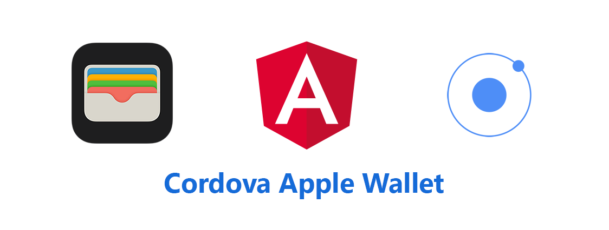

<a href="https://www.npmjs.com/package/cordova-apple-wallet">
    <h1 align="center">Cordova Apple Wallet</h1>
</a>

<p align="center">
Best way to integrate apple wallet into your mobile app. Cordova Apple Wallet let you add your credit/debit cards to Apple Wallet through your mobile app. It also can check if the credit/debit card exists in Wallet or any paired device e.g. Apple Watch ⌚
</p>




## Table of contents
1. [Getting Started](#getting-started)
2. [Supporting](#supporting-cordova-apple-wallet)
3. [Installation instructions](#installation-instructions)
4. [How to use](#how-to-use) 
5. [API](#api)
6. [Contributing](#contributing)
7. [License](#license)
8. [Credits](#credits)


## Getting Started

**Attention** Adding payment passes requires a special entitlement issued by Apple. Your app must include this entitlement before you can use this class. 
For more information on requesting this entitlement, see the Card Issuers section at [Apple Pay for issuers](https://developer.apple.com/apple-pay/).

For more technical information, please check Apple Developer documentation from [here](https://developer.apple.com/documentation/passkit/pkaddpaymentpassviewcontrollerdelegate/1615915-addpaymentpassviewcontroller?language=objc) and <a href="https://developer.apple.com/design/human-interface-guidelines/apple-pay/overview/offering-apple-pay/">Here</a>,


## Supporting cordova-apple-wallet
cordova-apple-wallet is an open source project (Apache-2.0), it's an independent project with ongoing development made possible thanks to the support of our awesome collaborators.

If you think that any information you obtained here is worth of some money and are willing to pay for it, you can give me a cup of coffee ☕ 😉


[](https://www.paypal.com/cgi-bin/webscr?cmd=_donations&business=hbasheer%40live.com&item_name=Business&currency_code=USD&source=url)


## Installation instructions

### Ionic / Angular

Use the typed wrapper from [Awesome Cordova Plugins](https://www.npmjs.com/package/@awesome-cordova-plugins/apple-wallet) (the project formerly known as Ionic Native):

  ```shell
  npm install cordova-apple-wallet @awesome-cordova-plugins/apple-wallet @awesome-cordova-plugins/core
  ```

### Cordova

  ```shell
  cordova plugin add cordova-apple-wallet --save
  ```

Or the latest version:

  ```shell
    cordova plugin add --save https://github.com/tomavic/cordova-apple-wallet
  ```


## How to use 


### (Ionic / Angular)

```typescript
import { inject } from '@angular/core';
import { AppleWallet } from '@awesome-cordova-plugins/apple-wallet/ngx';

// provide AppleWallet in your app config, then:
private readonly appleWallet = inject(AppleWallet);

async canAddCard(): Promise<boolean> {
  return this.appleWallet.isAvailable();
}
```

Every method below is available on the wrapper with the same name and arguments.


---

### (Vanilla JS)


👉 **NOTE**: _In order to use it with normal cordova based project, please define a global variable, so that you can use it without lint errors_ `var AppleWallet = AppleWallet || {};`


## API


1. [Availability](#apple-wallet-availability)
2. [Eligibility](#card-eligibility) 
3. [Card Addition](#card-addition)
4. [Paired Devices](#paired-devices) (🎁 NEW)


### ✔️ Apple Wallet Availability

Simple call to determine if the current device supports Apple Pay and has a supported card installed.


#### cordova example
```javascript
    AppleWallet.isAvailable()
    .then((res) => {
    /**
     * Expect res to be boolean
     */
    })
    .catch((err) => {
      // Catch {{err}} here
    });
```
---

### Card Eligibility


#### 1 - Check Card Eligibility

Simple call to check Card Eligibility

#### Parameters

__primaryAccountIdentifier__ (String) Your card unique identifier that used in card in-app provisioning

```javascript
    AppleWallet.checkCardEligibility(primaryAccountIdentifier)
    .then((res) => {
    /**
     * Expect res to be boolean
     */
    })
    .catch((err) => {
      // Catch {{err}} here
    });
```


#### 2 - Check Card Eligibility By Suffix
Simple call to checkCardEligibilityBySuffix

##### Parameters: 
__cardSuffix__ (String) The card number suffix ex: last 4 or 6 digits

```javascript
    AppleWallet.checkCardEligibilityBySuffix(cardSuffix)
    .then((res) => {
    /**
     * Expect res to be boolean
     */
    })
    .catch((err) => {
      // Catch {{err}} here
    });
```

---


### Card Addition

Simple call with the configuration data needed to instantiate a new PKAddPaymentPassViewController object.

This method provides the data needed to create a request to add your payment pass (credit/debit card). After a successful callback, pass the certificate chain to your issuer server-side using our callback delegate method `AppleWallet.completeAddPaymentPass`. The issuer server-side should returns an encrypted JSON payload containing the encrypted card data, which is required to be get the final response

```javascript
    let data = {
      cardholderName: 'Test User',
      primaryAccountSuffix: '1234',
      localizedDescription: 'Description of payment card',
      paymentNetwork: 'VISA',
      encryptionScheme: 'RSA_V2' // This could be ECC_V2 or RSA_V2 - Default is RSA_V2
    }
    AppleWallet.startAddPaymentPass(data)
    .then((res) => {
    /**
     * User proceed and successfully asked to add card to his wallet
     * Use the callback response JSON payload to complete addition process
     * Expect
     * res = {
     *   "data": {
     *     "certificateSubCA":"Base64 string represents certificateSubCA",
     *     "certificateLeaf":"Base64 string represents certificateLeaf"
     *     "nonce":"Base64 string represents nonce",
     *     "nonceSignature":"Base64 string represents nonceSignature",
     *   }
     * }
     */
    })
    .catch((err) => {
      // Error or user cancelled.
    });
```

👉 **NOTE**: _The encryption scheme, cardholder name, and primary account suffix are required for configuration. The configuration information is used for setup and display only. It should not contain any sensitive information._

In order to get testing data check this [Apple Sandbox](https://developer.apple.com/apple-pay/sandbox-testing)

---

### Card Addition Callback Delegate

Simple completion handler that takes encrypted card data returned from your server side, in order to get the final response from Apple to know if the card is added succesfully or not.

- `activationData`: The request’s activation data.
- `encryptedPassData` : An encrypted JSON file containing the sensitive information needed to add a card to Apple Pay.
- `ephemeralPublicKey` The ephemeral public key used by elliptic curve cryptography (ECC). or `wrappedKey` if you are using RSA

```javascript
    let encryptedData = {
        activationData: "encoded Base64 activationData from your server",
        encryptedPassData: "encoded Base64 encryptedPassData from your server",
        wrappedKey: "encoded Base64 wrappedKey from your server"
    }
    AppleWallet.completeAddPaymentPass(encryptedData)
    .then((res) => {
      /**
       * A success callback response means card has been added successfully,
       * PKAddPaymentPassViewController will be dismissed
       * Expect
       * res to be String value 'success' or 'error'
       */
    })
    .catch((err) => {
      // Error and can not add the card, or something wrong happend
      // PKAddPaymentPassViewController will be dismissed
    });
```


### Paired Devices

#### 1 - Check Paired Devices

Simple call to check out if there is any paired Watches so that you can toggle visibility of 'Add to Watch' button

```javascript
    AppleWallet.checkPairedDevices()
    .then((res) => {
    /**
     * Expect
     * res = {
     *   isWatchPaired: boolean
     * }
     */
    })
    .catch((err) => {
      // Catch {{err}} here
    });
```


#### 2 - Check Paired Devices By Suffix

Simple call to check paired devices with a card by its suffix
##### Parameters

__cardSuffix__ (String) The card number suffix ex: last 4 or 6 digits

```javascript
    AppleWallet.checkPairedDevicesBySuffix(cardSuffix)
    .then((res) => {
    /**
     * object contains boolean values that ensure that card is already exists in wallet or paired-watch
     * Expect
     * res = {
     *    isInWallet: boolean
     *    isInWatch: boolean
     *    FPANID: string
     * }
     * */
    })
    .catch((err) => {
      // Catch {{err}} here
    });
```

---


## Contributing

1. Fork it
2. Create your feature branch (`git checkout -b my-new-feature`)
3. Commit your changes (`git commit -am 'Add some feature'`)
4. Push to the branch (`git push origin my-new-feature`)
5. Create new Pull Request


## License

[Apache-2.0](./LICENSE)


## Credits

Feedback is welcome on [X](https://x.com/toomavic) or in [issues](https://github.com/tomavic/cordova-apple-wallet/issues).
